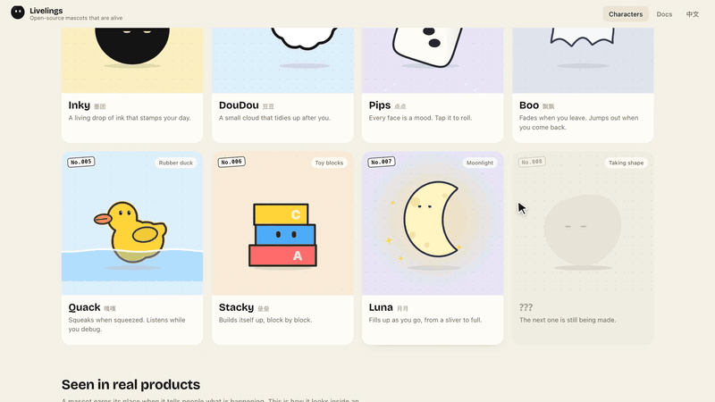

# Livelings 活宝

**Open-source mascots that are alive.** Seven characters drawn entirely in
code. They watch your cursor, think while your app thinks, cheer when it is
done and sulk when it fails, and each has tricks only it can do. Drop one into
a page in three lines, or make your own with the Livelings skill.

**Site:** https://livelings.makerjackie.com · [中文说明](#中文)

<p align="center"></p>

| | Character | What it is | Its own tricks |
|---|---|---|---|
| No.001 | **Puff** 小云 | a small cloud | rains, thunders, sunbathes, tidies up |
| No.002 | **Inky** 小墨 | a drop of ink | stamps your day, splats, writes, counts |
| No.003 | **Pips** 点点 | a die | tap to roll; every face is a mood |
| No.004 | **Boo** 飘飘 | a ghost | fades when you leave, jumps out when you return |
| No.005 | **Quack** 嘎嘎 | a rubber duck | squeaks when squeezed, flips over, listens while you debug |
| No.006 | **Stacky** 垒垒 | toy blocks | builds itself up; pull a block and it topples |
| No.007 | **Luna** 月月 | the moon | fills up as you make progress, from a sliver to full |

## Use one

```html
<script type="module" src="https://livelings.makerjackie.com/livelings.js"></script>
<live-ling character="cloud" state="thinking" style="width:160px;height:160px"></live-ling>
```

Add `sound` to the tag and each character makes its own sounds when people
play with it (synthesized, no files; off by default).

Then drive it from your app: `el.setAttribute('state', 'working')` for states,
`el.play('done')` for one-shots. Every character understands the same
vocabulary, so you can swap characters without changing code:

- **States (loop):** `idle` `thinking` `working` `waiting` `blocked` `listening` `sleep`
- **Reactions (once):** `acknowledge` `done` `error` `poked` `happy` `excited` `proud` `love` `surprised` `shy` `sad` `angry` `confused` `nod` `no` `hello` `celebrate`

…and each acts it out its own way: when the work is done, the die rolls a six,
the duck flaps and splashes, the blocks plant a flag and the moon turns full.

```ts
import { createMascot, CHARACTERS } from './livelings'

const m = createMascot(el, { character: CHARACTERS.duck, seed: user.id })
m.play('thinking') // states loop until another state
m.play('done')     // reactions play once, then hand back
```

Full docs: https://livelings.makerjackie.com/docs

## Make your own: the Livelings skill

`livelings-skill.zip` is a skill for Claude Code, Codex and other coding
agents. Tell it what your product is; it proposes a few characters, writes the
one you pick, and opens a studio with sixteen live copies where you can poke
it and export PNGs, pose sheets and short videos. It can also turn an article
into illustration cards with the same character every time.

```bash
# Claude Code (use ~/.codex/skills for Codex)
mkdir -p ~/.claude/skills && cd ~/.claude/skills
curl -fsSLO https://livelings.makerjackie.com/livelings-skill.zip
unzip -o livelings-skill.zip && rm livelings-skill.zip
```

Then just ask: *"use the livelings skill to make a mascot for my bakery"*.
Toasty, a slice of bread that pops out of its toaster when the work is done,
was made that way (`src/examples/toast.ts`). Characters you make are yours.

## How it works

- **One outline, 96 points.** Every silhouette (a cloud, a die, a duck, a
  traced digit) is resampled to the same 96 points, so any shape morphs into
  any other.
- **Springs, not tweens.** Behaviours only move targets (shape, eyes, lean,
  scale) and give impulses (hop, poke, spin). Every value is a spring, so any
  state can interrupt any other mid-flight without a jump. The tests check it.
- **Soft bodies.** Pokes, landings and drags dent the outline. Characters
  differ by their spring constants: ink is firm and splashes, a ghost floats.
- **It notices you.** Characters look at the cursor, lean towards it, flinch
  when it whips past, purr when it rests on them, giggle when tickled, get
  dizzy after three quick taps and cross after five. Some answer in their own
  way: the die rolls, the ghost vanishes, the duck squeaks, a block slides out.
- **Smooth and deterministic.** Each frame is simulated in sub-steps of at
  most 1/120 s, so motion follows the display's real refresh rate. Same seed,
  same frame times, same frames, so video can be exported frame by frame.
- **No dependencies.** The engine is plain TypeScript on a 2D canvas; the
  bundle is about 45 KB gzipped.

## Develop

```bash
pnpm install
pnpm dev      # site at http://localhost:5280
pnpm test     # engine tests: determinism, continuity, every action of every character
pnpm build    # site to dist/, plus dist/livelings.js and dist/livelings-skill.zip
pnpm run deploy   # build, then publish dist/ to livelings.makerjackie.com (Cloudflare Workers)
```

`src/engine` is the engine, `src/characters` the family, `src/site` the
website and `skill/livelings` the skill. While designing a character,
`/lab.html?c=dice,ghost&a=idle,done,error&t=0.4,1.2` renders a contact sheet
of characters × actions × moments (dev only).

`film/` is the source of the launch films: frame-exact captures of this site
and scenes drawn with the engine, edited in Remotion (see `film/README.md`).

## License & credits

- Code: MIT (`LICENSE`).
- Characters: CC BY 4.0 (`LICENSE-CHARACTERS.md`). Use them anywhere,
  commercial included, with the credit "Livelings by MakerJackie".
- The outline-morphing approach comes from
  [bloub](https://github.com/jeremy-prt/bloub) by Jérémy Perret (MIT), a
  recreation of xAI's Grok Bot avatar.
- Inky first lived in the [Inky Habits](https://apps.apple.com/app/id6788409678) app.
- Made by [MakerJackie](https://github.com/makerjackie). Want a character made
  for your product? Open an issue or get in touch.

---

## 中文

**活宝 Livelings：会动、会回应的开源吉祥物。** 七个全部用代码画出来的小角色：它们会盯着你的鼠标看；你的 App 在思考，它也在思考；做完了会欢呼，出错了会沮丧。每一个都有只属于自己的玩法。复制三行代码就能放进网页，也可以用「活宝 Skill」捏一个你自己的。

| | 角色 | 是什么 | 专属玩法 |
|---|---|---|---|
| No.001 | **小云** Puff | 一朵小云 | 下雨、打雷、晒太阳、收拾房间 |
| No.002 | **小墨** Inky | 一滴墨 | 帮你给每天盖章、溅开、写字、数数 |
| No.003 | **点点** Pips | 一颗骰子 | 点一下就掷，每一面都是一种心情 |
| No.004 | **飘飘** Boo | 一只幽灵 | 你一走它就隐身，你一回来它就吓你 |
| No.005 | **嘎嘎** Quack | 一只橡皮鸭 | 一捏就吱，会翻跟头，你讲 bug 它认真听 |
| No.006 | **垒垒** Stacky | 一摞积木 | 一块一块把自己垒起来，抽一块就塌 |
| No.007 | **月月** Luna | 一个月亮 | 你越往前，它就越圆 |

**用法**

```html
<script type="module" src="https://livelings.makerjackie.com/livelings.js"></script>
<live-ling character="cloud" state="thinking" style="width:160px;height:160px"></live-ling>
```

所有角色都听得懂同一套动作（思考、干活、等待、需要帮忙、完成、出错……），换角色不用改代码，但每个角色演出来都不一样。完整文档见网站的「文档」页。

**活宝 Skill**：给 Claude Code、Codex 等 AI 编程助手用的技能包。按上面的命令解压到 `~/.claude/skills`（Codex 是 `~/.codex/skills`），然后直接说「用 livelings skill 给我的面包店做一个吉祥物」。它会先给几个角色方案，你挑中哪个就写出哪个，再打开工作台让你戳一戳、导出 PNG／动作表／短视频；也能用同一个角色给文章配一组插画。示例角色「吐吐」（一片做完事就从吐司机里弹出来的面包）就是这样做出来的。你做出来的角色归你。

**协议**：代码 MIT；角色形象 CC BY 4.0，可以商用，署名「Livelings by MakerJackie」即可。想要为你的产品专门设计一个角色，欢迎来找 [MakerJackie](https://github.com/makerjackie)。
